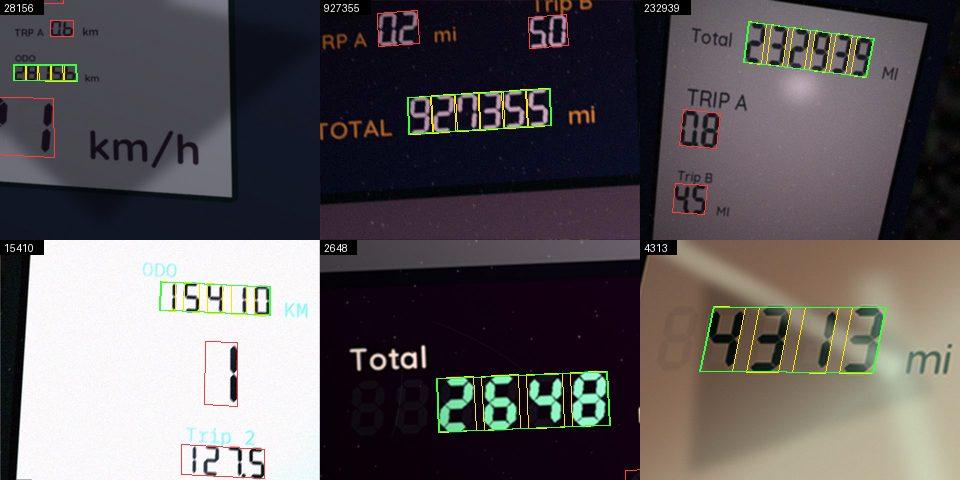
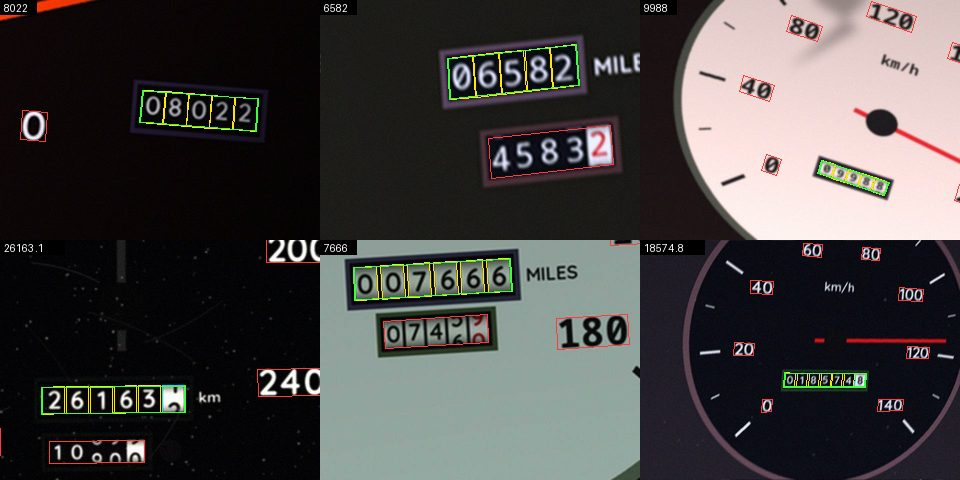
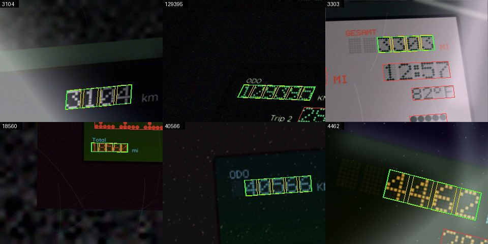
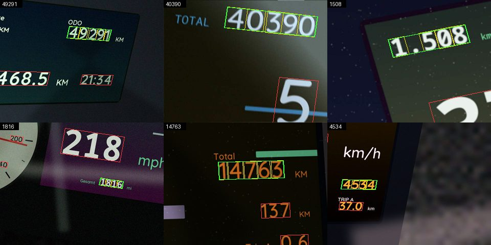

# Synthetic odometer photos (Epic backend#129, app#37)

Reading the odometer from a photo needs two models: one that finds the total-distance line (ODO) in the photo and
one that reads its digits (app#38, app#39). Both are trained and tested on **synthetic photos** from
`tools/odometer-model/generate.py`: free of licences, as many as needed, and labelled correctly by construction.
Real photos (app#41) are only the yardstick. The generator is not part of the app build.

```bash
cd tools/odometer-model
pip install -r requirements.txt                 # numpy, Pillow
python generate.py --count 1000 --seed 1        # → out/1-000000.jpg, out/1-000000.json, …, out/manifest.json
python generate.py --testset                    # the fixed test set: seed 37000, 400 photos → testset/
python gallery.py                               # the galleries below (docs/odometer-model/<kind>.jpg)
```

Options: `--out DIR`, `--kinds lcd7,drum,dotmatrix,tft` (spread evenly by index), `--size 640x480`, `--start N`
(first index, to extend a set), `--workers N`. 400 photos take about 20 s on 16 cores.

**Reproducible:** every photo comes from its own random stream `(seed, index)`. The same call gives the same
labels, and any single photo can be regenerated. Training uses other seeds than the test set (37000). Pixels may
differ slightly with other numpy/Pillow/libjpeg versions (`requirements.txt` pins the ones used); the labels do not.
The photos themselves are not in the repository (`.gitignore`).

## What is generated

| Kind (`kind`) | Display | Variation |
|---|---|---|
| `lcd7` | LCD with seven-segment digits | dark on light (with or without backlight) or light on dark; unlit segments visible or not; slanted; 7 with or without the left bar, 6 and 9 with or without tail; leading cells blank |
| `drum` | mechanical counter in a round dial | 5 or 6 rolls with leading zeros, tenths roll in its own colour or none, rolls **half turned** (with carry: …1299.9 → …1300), play between rolls, curved shading; trip counter below, dial numbers, needle |
| `dotmatrix` | dot-matrix display | round or square dots, unlit dots visible or not, labels in dots or printed |
| `tft` | colour screen of a modern cockpit | Noto Sans Mono and Quicksand in two weights each, thousands separator (`12.345`, `12,345`, `12 345`), bars and frames as clutter |

**Distractors** (labelled, so a detector can be checked for mix-ups): trip meters (also two, A/B), clock, outside
temperature, range, consumption, speed in large digits, gear, and the numbers of a dial (`scale`). Labels such as
ODO, TOTAL, Gesamt, TRIP A, RANGE, Reichweite and units km, mi, km/h, mph are printed next to them.

**Photo:** perspective and tilt, rotation up to ±30°, the ODO line at 12–65 % of the photo width, surroundings;
day with uneven light and shadows, night with the display glowing and/or flash with a glare spot, against the light
(haze, low contrast); glass with reflections, dust and scratches; blur, motion blur, noise, white balance,
exposure, JPEG quality 55–95.

## Label format (`<seed>-<index>.json`)

Points are pixels of the photo, quads are four corners clockwise from the top left of the upright display.

```jsonc
{
  "version": 1, "seed": 2, "index": 1, "image": "2-000001.jpg", "kind": "drum", "width": 640, "height": 480,
  "value": 95553,            // the reading in whole km/mi – what the app should suggest
  "text": "095553",          // the integer digits as shown (leading zeros on rolls, none on displays)
  "tenths": 1,               // tenths digit if shown (to be read and discarded), else null
  "unit": "km",              // km or mi
  "odo": [[241.5, 255.8], [450.1, 259.6], [447.3, 303.1], [238.1, 298.9]],   // ODO line: all its digits
  "digits": [{"digit": 0, "quad": […], "tenths": false, "turn": 0.005}, …],  // left to right, tenths last
  "distractors": [{"type": "trip", "text": "0743.6", "quad": […], "complete": true}, …],
  "conditions": {"angle": -3.2, "tilt": 0.08, "light": "night", "flash": true, "blur": 0.9, "jpeg": 81, …}
}
```

- `odo` spans the digits only (with the tenths), not the label or the unit. Blank cells of an LCD are not part of it.
- `turn` (rolls only): how far the roll has turned towards the next digit, 0 to 1; small negative values are play.
  **`digit` is always the lower digit** – a counter is read like a meter – and `value` is made of these digits. A
  roll with a `turn` around 0.2–0.8 shows two half digits; the reader should flag it as unsure (app#39).
- `distractors[].complete`: whether all four corners are inside the photo. Distractors entirely outside are left out.
- The digit box is the character cell (segments: the cell incl. slant; rolls: the visible part of the roll; fonts
  and dots: advance × digit height), not the tight outline of the ink.

## Galleries

Green: ODO line, yellow: its digits, cyan: tenths, red: distractors; top left the labelled value.

**`lcd7`** 

**`drum`** 

**`dotmatrix`** 

**`tft`** 

## ODO line detector (app#38)

Finds the total-distance line in a photo, entirely on the phone: `domain/odometer/OdoDetector` (plain Kotlin like
`DigitClassifier`, no library, no network), weights in `app/src/main/assets/odo-detector.bin` (765 KB).

**Why plain Kotlin and not LiteRT/TFLite:** no dependency and no native code in the APK, the same pattern as the
digit model, and the network is small enough that a hand-written forward pass stays short (about 360 lines incl.
loading). If it turns out too slow on phones, LiteRT is the fallback.

**Model:** a small U-Net. Input: the photo in grey, area-averaged to 192×144 and normalised per photo (mean 0,
std 1). Encoder 12 → 24 → 32 → 48 channels with max pooling, bottleneck 64 at 12×9, decoder with skip connections
back to 96×72, 3×3 convolutions with ReLU (batch norms folded in on export). Output: per cell of a 96×72 grid the
probability that it belongs to the ODO line (trained with BCE + Dice against the share of the cell covered by the
labelled `odo` quad).

**From mask to corners:** cells above 0.5, the connected region with the largest probability mass, then an oriented
rectangle from its second moments (centre, direction of the long axis, length and height from the variances). The
same steps in Python (`quad_of`) and Kotlin (`lineOf`); on the target masks themselves this gives IoU ≥ 0.78
(median 0.94), so the geometry is not the limit. `OdoLine.confidence` is the mean probability of the region; below
0.75 it is `unsure` and the user should check the frame (app#40). No region: no line, the user draws it.

**Results** on the fixed test set (400 photos, seed 37000, not trained on):

| | |
|---|---|
| ODO line found (IoU ≥ 0.7) | **386 / 400 = 96.5 %**, median IoU 0.938 |
| per kind | drum 100/100, lcd7 96/100, tft 96/100, dotmatrix 94/100 |
| misses | trip meter taken instead 3, partly on the line 3, elsewhere 5, nothing found 3 |
| clock taken instead | 0 |
| inference | 98 ms per photo on a desktop JVM (one thread); on phones to be measured with app#40 |

Real photos (app#41) are not collected yet; their results will be added here.

**Training** (`tools/odometer-model/train_detector.py`, PyTorch, uses CUDA if available):

```bash
cd tools/odometer-model
pip install -r requirements.txt torch
python generate.py --count 30000 --seed 1 --out out/train --workers 16
python generate.py --testset
python train_detector.py prepare out/train cache/train.npz
python train_detector.py prepare testset cache/test.npz
python train_detector.py train 40      # → odo-detector.bin, odo-reference.txt (and cache/detector.pt)
python train_detector.py eval          # the table above; per photo in cache/eval.tsv
cp odo-detector.bin ../../app/src/main/assets/ && cp odo-reference.txt ../../app/src/test/resources/odometer/
```

40 epochs take about 18 minutes on an RTX 5070 Ti (about 30 s each, mostly augmentation on the CPU), several hours on
16 CPU cores. The last 1,000 training photos are held out for validation; augmentation adds a brightness curve and
shifts of up to 8 px. Seeds are fixed (38), but GPU training is not bit-exact – a new run gives similar, not equal
numbers.

`OdoDetectorTest` checks that the Kotlin forward pass matches PyTorch on a fixed input (`odo-reference.txt`: sums and
every 997th logit), plus the geometry, the scaling and that broken files are rejected.

**Weights format `BMO1`:** magic, tensor count, then per tensor rank, dimensions and little-endian float32 – conv
weight and bias per layer in the order e1, e2, e3 (×2), e4 (×2), bottleneck (×2), d4, d3, d2, then the 1×1 head.

## ODO line reader (app#39)

Reads the digits of the ODO line: `domain/odometer/OdoReader` (plain Kotlin, shares the layers in `Nn.kt` with the
detector), weights in `app/src/main/assets/odo-reader.bin` (750 KB). The value goes through `OdoPlausibility`
against the last known mileage.

**Crop:** the four corners with a margin (25 % of the line height above and below, 30 % left and right) are mapped
onto a 32 px high strip of at most 160 px (perspective, bilinear, supersampled where the line is larger), rounded to
whole grey values, normalised per strip. `OdoReader.crop` and `crop` in `train_reader.py` do the same steps; the test
photos in `app/src/test/resources/odometer/` check that both give the same strip.

**Model:** five 3×3 convolutions (32, 48, 64, 64, 96 channels, pooled down to 4 × 40), max over the height, two
convolutions along the line (96), then per column of 40: blank, digits 0–9, **tenths digits 0–9** (the 100 m roll or
the digit after a decimal point: read and dropped), and a flag whether a roll is **turning** there. Trained with CTC
(no split into single digits needed, which helps with half-turned rolls) plus the turning flag (weighted 5×, as it is
rare), on 60,000 crops of 30,000 synthetic photos, two per photo with corners moved like a detector would (σ 7 % of
the line height, ±12 % longer or shorter).

**Reading** (`candidates`, same in Python and Kotlin): greedy CTC with both roles of a digit merged. Whether the last
digit is the tenths one is often not visible – a 100 m roll in the same colour as the others, no decimal point; a
person cannot tell either – so up to two readings come out: all digits, and the last one dropped as tenths. A reading
is **unsure** if

- a digit's probability is below 0.98,
- a roll is turning under one of its digits (flag above 0.3) – a half-turned roll counts as its lower digit, like
  reading a meter,
- a blank column shows a digit that none of its neighbours reads (a digit may be missing), or
- the dropped tenths digit is 9 or 0: the next roll is turning along with it (carry).

**Plausibility** (`OdoPlausibility`): a value below the last mileage or more than 20,000 above it does not fit. If
exactly one reading fits, it is taken (unsure only if its digits are); if both fit (small mileages, below about
2,500), none fits, or there is no last mileage, the value is marked for checking. The app always has the vehicle's
mileage, so the second case is the normal one.

**Results** on the fixed test set (400 photos, not trained on), with a last mileage 0–3,000 km below the true value:

| | right | right and sure | sure and wrong |
|---|---|---|---|
| straightened from the labelled corners | **393 / 400 = 98.2 %** | 313 | **0** |
| the whole way: corners from the detector | 374 / 400 = 93.5 % | 297 | 3 (wrong area found) |

- By kind, right and sure: tft 90, lcd7 84, dotmatrix 83, drum 56 of 100. Mechanical counters are flagged most:
  turning rolls and tenths rolls in the same colour.
- 20 % of the right values are flagged, mostly because both readings fit: the generator draws many small mileages.
  For mileages from 5,000 km on, 7.8 % of the right values are flagged.
- The 3 sure-and-wrong values of the whole way come from the 3.5 % of photos where the detector frames something
  else (app#38); the user sees the frame on the photo (app#40).
- Known limit: a units roll turned 90 % or more on a counter without tenths roll may be read as the next digit
  (1 km too much) without a flag. Checked on the 2,000 held-out training crops: 2 of 2,000.

Real photos (app#41) are not collected yet; their results will be added here.

**Training** (`tools/odometer-model/train_reader.py`, uses CUDA if available, 40 epochs about 10 minutes on an
RTX 5070 Ti):

```bash
cd tools/odometer-model
python train_reader.py prepare out/train cache/reader-train.npz 2   # 2 crops per photo with moved corners
python train_reader.py prepare testset cache/reader-test.npz 0      # exact crops from the labels
python train_reader.py train 40     # → odo-reader.bin, odo-reader-reference.txt (and cache/reader.pt)
python train_reader.py eval         # the table above (also needs cache/detector.pt)
cp odo-reader.bin ../../app/src/main/assets/ && cp odo-reader-reference.txt ../../app/src/test/resources/odometer/
```

The thresholds (0.98, 0.3, 0.35, the carry rule) were chosen on the held-out training crops, not on the test set.
`OdoReaderTest` checks the Kotlin forward pass against `odo-reader-reference.txt`, the crop and the value of three
test photos against the Python code, and the plausibility and roll rules on made-up model outputs.

**Weights format `BMR1`:** like `BMO1` – conv weight and bias of the five 2-D and two 1-D layers, then class head
and turning head.

## In the app (app#40)

"Photograph odometer" is the camera button in the mileage field of the vehicle page's "Enter mileage" dialog and of
"Log maintenance" (`ui/odometer/`). The flow:

1. **Camera** (`PhotoCamera`, shared with the worksheet scan): a 4:3 landscape frame as guide, the flash as a torch
   if the phone has one. The camera permission is asked only on the first tap; without it the mileage is typed in as
   before.
2. **Reading** (`AndroidOdometerScanner`, off the main thread): the 4:3 area in the middle of the photo
   (`odoPhotoArea` – the models only know landscape photos), the line detector, then the reader against the vehicle's
   current mileage.
3. **Review:** the photo with the line framed, the straightened line, the value (editable). Unsure values (reader or
   detector frame) are marked until the user edits them. "Adjust the area" lets the user drag a frame on the photo if
   the wrong line was found or none.
4. **Take over** fills the mileage field; it is saved only with the form's "Save".

The photo lives only in the screen's ViewModel (memory) and is dropped once the value is taken over or the screen
closes – never saved, never sent, not kept across a process restart.

## Licences

Code, generated photos and the weights trained on them (`odo-detector.bin`, `odo-reader.bin`) and the test photos
in `app/src/test/resources/odometer/`: MIT like the rest of the app – no third-party images go in. Fonts (only in the
generator, `tools/odometer-model/fonts/`): Noto Sans Mono (© Google) and Quicksand (© The Quicksand Project
Authors), both SIL Open Font License 1.1 without Reserved Font Name, as subsets; sources and the subset command in
`fonts/README.md`. Seven-segment and dot-matrix digits are drawn by the code. Known limits: no real cockpit
designs, no fonts of particular manufacturers, no curved glass – the real photos of app#41 show what that costs.
