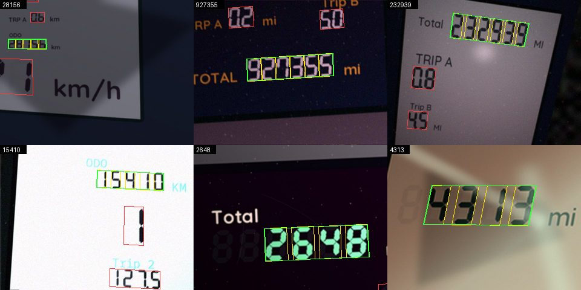
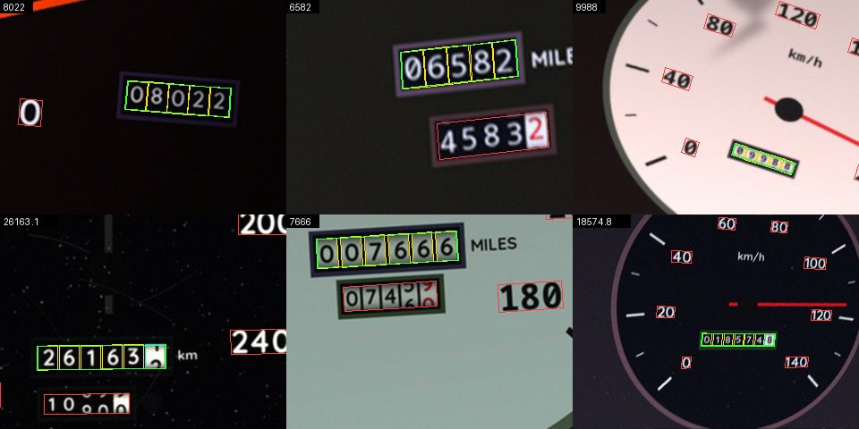
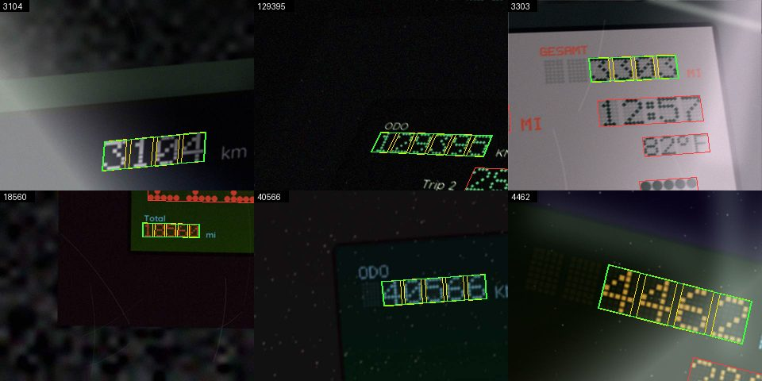
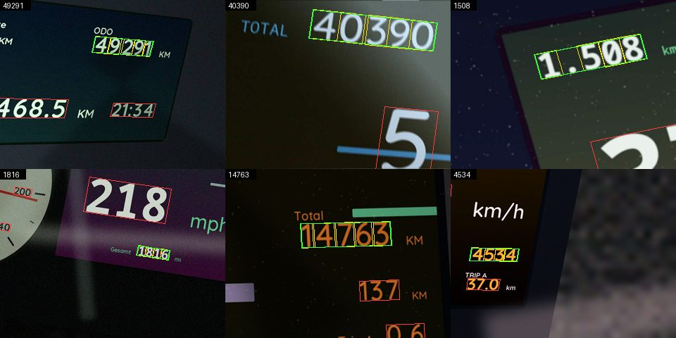

# Synthetic odometer photos (Epic backend#129, app#37)

Reading the odometer from a photo needs two models: one that finds the total-distance line (ODO) in the photo and
one that reads its digits (app#38, app#39). Both are trained and tested on **synthetic photos** from
`tools/odometer-model/generate.py`: free of licences, as many as needed, and labelled correctly by construction.
Real photos (app#41) are only the yardstick. The generator is not part of the app build.

```bash
cd tools/odometer-model
pip install -r requirements.txt                 # numpy, Pillow
python generate.py --count 1000 --seed 1        # → out/1-000000.jpg, out/1-000000.json, …, out/manifest.json
python generate.py --testset                    # the fixed test set: seed 37000, 400 photos → testset/
python gallery.py                               # the galleries below (docs/odometer-model/<kind>.jpg)
```

Options: `--out DIR`, `--kinds lcd7,drum,dotmatrix,tft` (spread evenly by index), `--size 640x480`, `--start N`
(first index, to extend a set), `--workers N`. 400 photos take about 20 s on 16 cores.

**Reproducible:** every photo comes from its own random stream `(seed, index)`. The same call gives the same
labels, and any single photo can be regenerated. Training uses other seeds than the test set (37000). Pixels may
differ slightly with other numpy/Pillow/libjpeg versions (`requirements.txt` pins the ones used); the labels do not.
The photos themselves are not in the repository (`.gitignore`).

## What is generated

| Kind (`kind`) | Display | Variation |
|---|---|---|
| `lcd7` | LCD with seven-segment digits | dark on light (with or without backlight) or light on dark; unlit segments visible or not; slanted; 7 with or without the left bar, 6 and 9 with or without tail; leading cells blank |
| `drum` | mechanical counter in a round dial | 5 or 6 rolls with leading zeros, tenths roll in its own colour or none, rolls **half turned** (with carry: …1299.9 → …1300), play between rolls, curved shading; trip counter below, dial numbers, needle |
| `dotmatrix` | dot-matrix display | round or square dots, unlit dots visible or not, labels in dots or printed |
| `tft` | colour screen of a modern cockpit | Noto Sans Mono and Quicksand in two weights each, thousands separator (`12.345`, `12,345`, `12 345`), bars and frames as clutter |

**Distractors** (labelled, so a detector can be checked for mix-ups): trip meters (also two, A/B), clock, outside
temperature, range, consumption, speed in large digits, gear, and the numbers of a dial (`scale`). Labels such as
ODO, TOTAL, Gesamt, TRIP A, RANGE, Reichweite and units km, mi, km/h, mph are printed next to them.

**Photo:** perspective and tilt, rotation up to ±30°, the ODO line at 12–65 % of the photo width, surroundings;
day with uneven light and shadows, night with the display glowing and/or flash with a glare spot, against the light
(haze, low contrast); glass with reflections, dust and scratches; blur, motion blur, noise, white balance,
exposure, JPEG quality 55–95.

## Label format (`<seed>-<index>.json`)

Points are pixels of the photo, quads are four corners clockwise from the top left of the upright display.

```jsonc
{
  "version": 1, "seed": 2, "index": 1, "image": "2-000001.jpg", "kind": "drum", "width": 640, "height": 480,
  "value": 95553,            // the reading in whole km/mi – what the app should suggest
  "text": "095553",          // the integer digits as shown (leading zeros on rolls, none on displays)
  "tenths": 1,               // tenths digit if shown (to be read and discarded), else null
  "unit": "km",              // km or mi
  "odo": [[241.5, 255.8], [450.1, 259.6], [447.3, 303.1], [238.1, 298.9]],   // ODO line: all its digits
  "digits": [{"digit": 0, "quad": […], "tenths": false, "turn": 0.005}, …],  // left to right, tenths last
  "distractors": [{"type": "trip", "text": "0743.6", "quad": […], "complete": true}, …],
  "conditions": {"angle": -3.2, "tilt": 0.08, "light": "night", "flash": true, "blur": 0.9, "jpeg": 81, …}
}
```

- `odo` spans the digits only (with the tenths), not the label or the unit. Blank cells of an LCD are not part of it.
- `turn` (rolls only): how far the roll has turned towards the next digit, 0 to 1; small negative values are play.
  **`digit` is always the lower digit** – a counter is read like a meter – and `value` is made of these digits. A
  roll with a `turn` around 0.2–0.8 shows two half digits; the reader should flag it as unsure (app#39).
- `distractors[].complete`: whether all four corners are inside the photo. Distractors entirely outside are left out.
- The digit box is the character cell (segments: the cell incl. slant; rolls: the visible part of the roll; fonts
  and dots: advance × digit height), not the tight outline of the ink.

## Galleries

Green: ODO line, yellow: its digits, cyan: tenths, red: distractors; top left the labelled value.

**`lcd7`** 

**`drum`** 

**`dotmatrix`** 

**`tft`** 

## Licences

Code and generated photos: MIT like the rest of the app – no third-party images go in. Fonts (only in the
generator, `tools/odometer-model/fonts/`): Noto Sans Mono (© Google) and Quicksand (© The Quicksand Project
Authors), both SIL Open Font License 1.1 without Reserved Font Name, as subsets; sources and the subset command in
`fonts/README.md`. Seven-segment and dot-matrix digits are drawn by the code. Known limits: no real cockpit
designs, no fonts of particular manufacturers, no curved glass – the real photos of app#41 show what that costs.
